# Cross-domain sentiment analysis

NLP group project. Three review domains, four models, three evaluation settings.

## Summary

We trained a majority-class baseline, two TF-IDF classifiers and a fine-tuned DistilBERT model
on movie, business and product reviews, then measured how much performance they lose when the
test reviews come from a different domain. Within a domain DistilBERT reached 0.902 to 0.949
macro-F1 and the TF-IDF models 0.879 to 0.932. Crossing a domain boundary cost DistilBERT
between 0.000 and 0.097 macro-F1 depending on the direction, and cost the TF-IDF models about
twice as much on average (0.063 and 0.065 against 0.034). Training on two domains and testing
on the third changed scores by at most 0.022 macro-F1, which is close to the variation between
seeds, so that part of the study is inconclusive.

## 1. Introduction

Online reviews are one of the few places where a business can read what customers think at a
volume nobody can read by hand. A sentiment classifier can do that reading automatically, but
it learns the vocabulary of the reviews it was trained on. A model trained on film criticism
meets different words when it reads restaurant complaints, and the word "unpredictable" can
praise a plot or describe a defect in a power bank.

The project asks two things. First, how much performance does a sentiment model lose when the
test domain differs from the training domain? Second, does training on more than one domain
reduce that loss?

## 2. Data

Three English review datasets, each cut to the same size so that a larger training pool cannot
explain a performance difference.

| Dataset | Domain | Train | Test | Positive class |
|---|---|---:|---:|---|
| IMDb | movie reviews | 20,000 | 10,000 | rating 7 and above |
| Yelp Polarity | business and service reviews | 20,000 | 10,000 | 3 to 4 stars |
| Amazon Polarity | product reviews | 20,000 | 10,000 | 4 to 5 stars |

The prepared validation split holds 2,000 rows per domain. Model selection used part of it:
1,000 rows for the within-domain runs and 4,000 rows for the mixed-domain runs, as recorded in
`configs/final.yaml`.

The three datasets define the positive class differently. Yelp treats 3 and 4 stars as positive
and drops 5-star reviews, so its positive class is milder than IMDb's (7 out of 10) and
Amazon's (4 out of 5 stars). This comes from the source data and affects comparisons of
absolute scores across domains.

Exact duplicates are removed on normalised text across all splits and all three datasets; the
first occurrence wins, so a review that appears in both IMDb and Amazon stays in IMDb. A second
pass checked for near-duplicates that exact matching would miss. It samples eight word 5-gram
shingles per review as an index key, then scores candidate pairs with an exact Jaccard
similarity, flagging pairs at 0.8 or above. Over the 90,000 training and test reviews
(validation was not part of this check) it found 11 pairs, all inside IMDb: none crossed
datasets and none crossed the train and test split of a domain.

Two artefacts survived cleaning. IMDb reviews carry HTML line-break tags in the source text,
and Amazon Polarity contains a few non-English reviews. We left both in place.

## 3. Models and settings

| Model | Settings |
|---|---|
| Majority class | predicts the most frequent training label |
| TF-IDF + Logistic Regression | word 1-2 grams, sublinear term frequency, C tuned per domain on validation |
| TF-IDF + Linear SVM | same features, C tuned per domain on validation |
| DistilBERT | distilbert-base-uncased, max length 256, batch 32, 3 epochs, learning rate 2e-5, best epoch chosen on validation |

The vectoriser sees training text and nothing else. We picked the DistilBERT learning rate on
IMDb validation, where 2e-5 and 3e-5 both landed on 0.9090 after four decimals; the script kept
2e-5 and every domain uses that value. Neither the test split nor the target domain had a say
in any of it.

We ran three settings. The first keeps training and testing inside one domain. The second trains
on one domain and evaluates on the other two, reusing the checkpoint rather than retraining for
each direction. The third combines two domains for training and holds the third out, with the
training set fixed at 20,000 rows (10,000 from each source) so that what changes between runs is
domain diversity and not the amount of data.

## 4. Results

### 4.1 Within a domain

| Model | IMDb | Yelp | Amazon |
|---|---|---|---|
| Majority class | 0.333 | 0.333 | 0.333 |
| TF-IDF + LR | 0.898 | 0.925 | 0.879 |
| TF-IDF + SVM | 0.900 | 0.932 | 0.881 |
| DistilBERT | 0.902 | 0.949 | 0.925 |
| Average of the three classifiers | 0.900 | 0.935 | 0.895 |

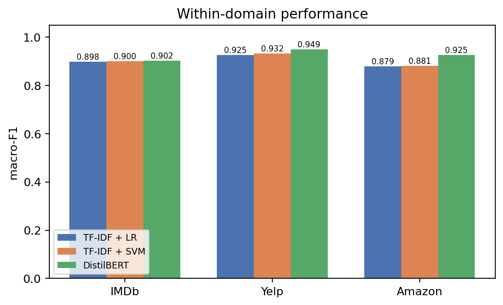

Yelp is the easiest domain for all three classifiers and Amazon the hardest for both TF-IDF
models. DistilBERT is ahead everywhere, but on IMDb the margin over TF-IDF SVM is 0.002, which
is smaller than the seed-to-seed spread in 4.5. On IMDb the two should be treated as tied.

### 4.2 Across domains

Cells on the diagonal repeat the within-domain score. Off the diagonal, the row is the training
domain and the column the test domain.

**TF-IDF + LR**

| Trained on | Tested on IMDb | Tested on Yelp | Tested on Amazon |
|---|---|---|---|
| IMDb | 0.898 | 0.855 | 0.820 |
| Yelp | 0.789 | 0.925 | 0.828 |
| Amazon | 0.851 | 0.883 | 0.879 |

**TF-IDF + SVM**

| Trained on | Tested on IMDb | Tested on Yelp | Tested on Amazon |
|---|---|---|---|
| IMDb | 0.900 | 0.847 | 0.816 |
| Yelp | 0.790 | 0.932 | 0.833 |
| Amazon | 0.864 | 0.888 | 0.881 |

**DistilBERT**

| Trained on | Tested on IMDb | Tested on Yelp | Tested on Amazon |
|---|---|---|---|
| IMDb | 0.902 | 0.901 | 0.880 |
| Yelp | 0.851 | 0.949 | 0.906 |
| Amazon | 0.887 | 0.925 | 0.925 |

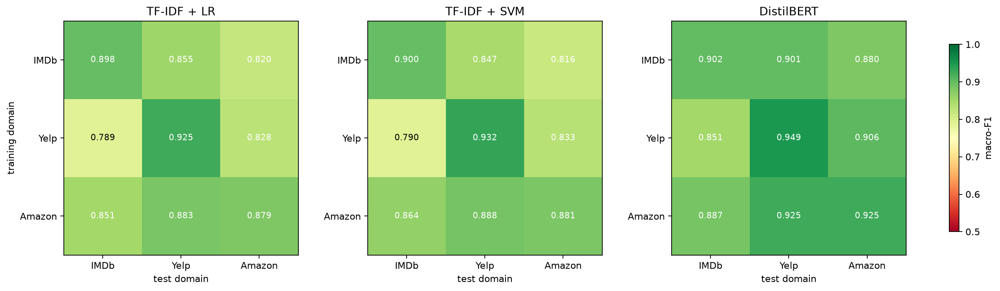

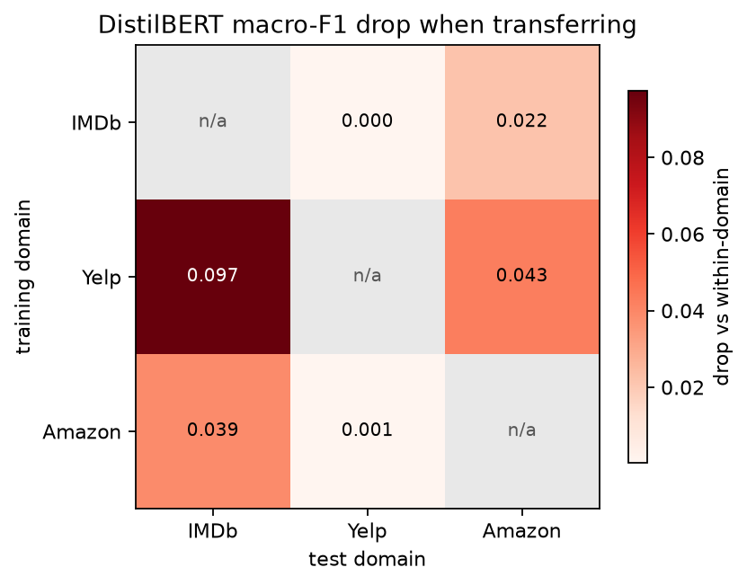

For DistilBERT the largest loss is Yelp to IMDb at 0.097 macro-F1 and the smallest are IMDb to
Yelp (0.000) and Amazon to Yelp (0.001). Averaged over the two directions, the target domain
explains a little more of the loss than the source: the mean drop by target ranges from 0.000
(Yelp as target) to 0.068 (IMDb as target), a spread of 0.068, while the mean drop by source
ranges from 0.011 to 0.070, a spread of 0.059. Both matter, and the asymmetry is real: a model
trained on long film reviews handles short reviews well, but a model trained on short verdicts
struggles with film reviews.

The TF-IDF models show the same pattern with larger losses. Their worst case is also Yelp to
IMDb (0.136 and 0.143), and they gain slightly when Amazon is the source and Yelp the target
(about 0.004 and 0.007).

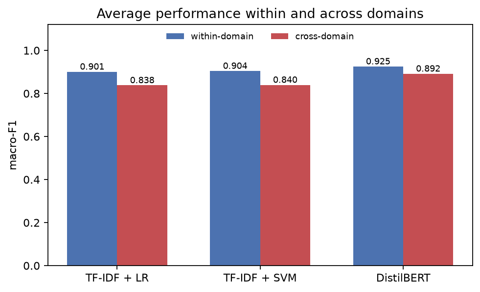

Averaged over all six directions, DistilBERT keeps 0.892 macro-F1 across domains against 0.925
within them, while the two TF-IDF models fall from about 0.90 to about 0.84.

### 4.3 How different are the domains?

| Domain pair | Jensen-Shannon divergence | Top-5000 word overlap | Mean words |
|---|---|---|---|
| IMDb / Yelp | 0.2248 | 0.346 | 228.8 / 133.1 |
| IMDb / Amazon | 0.1455 | 0.514 | 228.8 / 74.3 |
| Yelp / Amazon | 0.1785 | 0.413 | 133.1 / 74.3 |

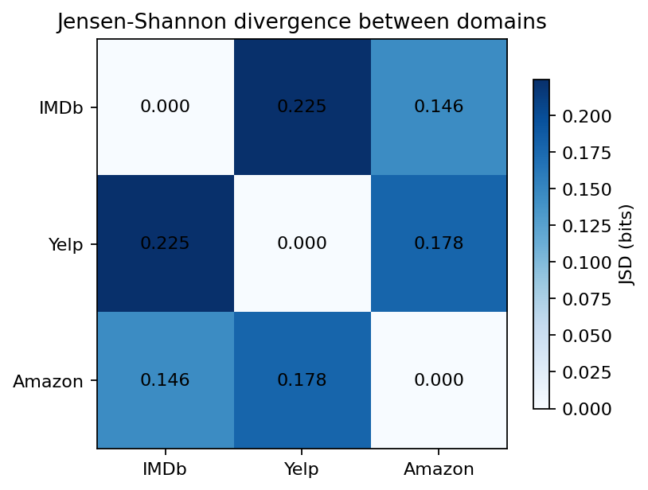

Vocabulary distance does not line up with the size of the transfer loss. IMDb and Amazon are the
closest pair by Jensen-Shannon divergence (0.146), partly because Amazon reviews cover films and
books, yet moving between them still costs DistilBERT 0.022 and 0.039 macro-F1. IMDb and Yelp
are the most distant pair (0.225), and one direction of that transfer costs nothing.

Review length tracks the loss better. IMDb averages 229 words, Yelp 133 and Amazon 74, and the
two models trained on short reviews lose most when IMDb is the target (0.039 from Amazon, 0.097
from Yelp). Section 5.2 shows the same effect inside a single setting.

### 4.4 Training on two domains

| Model | Trained on | Tested on | Mixed | Best single source | Delta |
|---|---|---|---|---|---|
| DistilBERT | imdb + yelp | Amazon | 0.913 | 0.906 | 0.007 |
| DistilBERT | yelp + amazon | IMDb | 0.881 | 0.887 | -0.006 |
| DistilBERT | imdb + amazon | Yelp | 0.920 | 0.925 | -0.005 |
| TF-IDF + LR | imdb + yelp | Amazon | 0.844 | 0.828 | 0.016 |
| TF-IDF + LR | yelp + amazon | IMDb | 0.828 | 0.851 | -0.022 |
| TF-IDF + LR | imdb + amazon | Yelp | 0.874 | 0.883 | -0.009 |
| TF-IDF + SVM | imdb + yelp | Amazon | 0.847 | 0.833 | 0.014 |
| TF-IDF + SVM | yelp + amazon | IMDb | 0.853 | 0.864 | -0.011 |
| TF-IDF + SVM | imdb + amazon | Yelp | 0.879 | 0.888 | -0.009 |

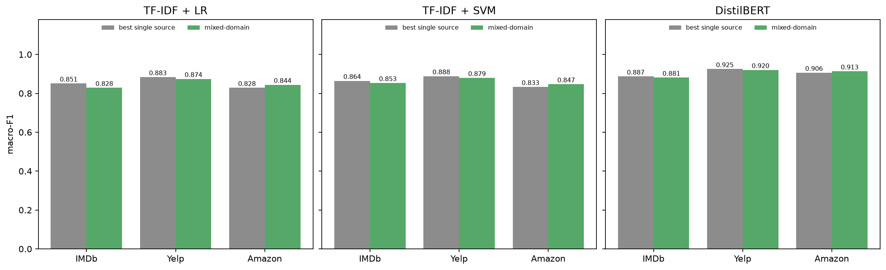

Three of the nine combinations beat the best single source, all of them with Amazon as the
target, and the mean change across all nine is -0.003 macro-F1. The gains are between 0.007 and
0.016, which is the same order as the seed-to-seed spread reported in 4.5. The honest reading is
that mixing two domains at a fixed training budget did not reliably help. Amazon gains because
it is the most heterogeneous domain, so a second source adds vocabulary; IMDb's difficulty comes
from long, mixed-tone text, which extra vocabulary does not fix.

### 4.5 Variation between seeds

| Domain | Seeds | Runs | Mean | Std | Min | Max |
|---|---|---|---|---|---|---|
| IMDb | 42, 43, 44 | 3 | 0.9066 | 0.0043 | 0.9018 | 0.9103 |
| Yelp | 42, 43, 44 | 3 | 0.9429 | 0.0065 | 0.9358 | 0.9486 |
| Amazon | 42, 43, 44 | 3 | 0.9278 | 0.0021 | 0.9254 | 0.9294 |

Three runs of the same configuration land up to 0.013 macro-F1 apart. That number is the
yardstick for everything else here. Losses of 0.02 to 0.10 survive it. The 0.002 IMDb gap
between DistilBERT and TF-IDF SVM does not. And the mixed-domain shifts, 0.005 to 0.022, sit
right on the boundary.

### 4.6 What the classifiers key on

| Polarity | Domain pair | Shared terms in top 20 | Jaccard | Example shared words |
|---|---|---|---|---|
| positive | IMDb / Yelp | 11 | 0.379 | amazing, best, excellent, great, love, perfect |
| positive | IMDb / Amazon | 12 | 0.429 | amazing, best, enjoyed, great, love, perfect |
| positive | Yelp / Amazon | 11 | 0.379 | amazing, best, excellent, great, love, perfect |
| negative | IMDb / Yelp | 9 | 0.290 | awful, bad, horrible, poor, terrible, worst |
| negative | IMDb / Amazon | 12 | 0.429 | bad, boring, horrible, poor, waste, worst |
| negative | Yelp / Amazon | 10 | 0.333 | bad, horrible, no, not, poor, worst |

Positive words carry across. Every pair of domains shares eleven or twelve of its twenty
strongest positive terms, and those terms are plain sentiment adjectives. Negative vocabulary
overlaps a little less, and the top negative features differ in kind: IMDb's are sentiment words
such as awful and boring, while Yelp's and Amazon's lists include negation markers (no, not,
don). A model that reads negation as the main negative signal will misfire on a domain that
expresses negativity through adjectives instead.

One caveat: these lists use a single regularisation strength (C=1.0), not the per-domain values
from the main runs. Rankings can only be compared if each domain's model is configured
identically, so the shared value is deliberate.

### 4.7 Does more training data help?

| IMDb training rows | Test IMDb | Test Yelp | Test Amazon |
|---|---|---|---|
| 5,000 | 0.893 | 0.901 | 0.893 |
| 10,000 | 0.894 | 0.902 | 0.896 |
| 20,000 | 0.902 | 0.901 | 0.880 |

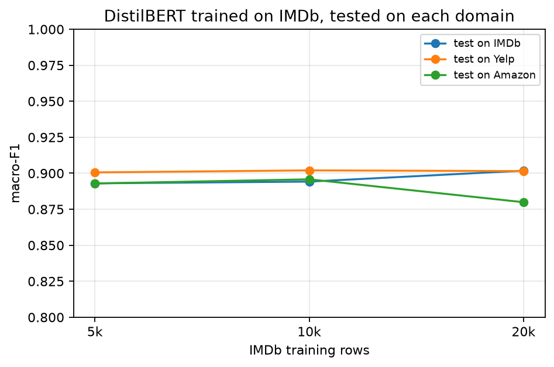

Four times the IMDb data buys 0.009 macro-F1 inside the domain. The two cross-domain scores stay
flat (Yelp) or slip a little (Amazon, -0.013, inside seed variation). At this scale extra
in-domain data does not close the gap, which points at vocabulary and length mismatch rather
than data scarcity.

## 5. Error analysis

### 5.1 Confusion direction

The counts below are exact; they are read from the confusion matrices in
`results/cross_metrics.json`, each computed over the 10,000 test reviews of the target domain.

| Setting | Negative scored positive | Positive scored negative | Total errors |
|---|---|---|---|
| Amazon to IMDb | 509 | 625 | 1,134 |
| Amazon to Yelp | 373 | 378 | 751 |
| IMDb to Amazon | 947 | 248 | 1,195 |
| IMDb to Yelp | 646 | 338 | 984 |
| Yelp to Amazon | 396 | 544 | 940 |
| Yelp to IMDb | 328 | 1,150 | 1,478 |

The direction of the errors follows the source domain. A model trained on IMDb calls 947
negative Amazon reviews positive against 248 the other way. IMDb negative reviews are long and
dramatic, so the model expects strong language before it says negative; Amazon negatives are
milder and often include a compliment, and the model reads the compliment as the verdict. The
opposite happens with a Yelp-trained model on IMDb, which marks 1,150 positive reviews negative
against 328 the other way, because long emotional prose looks like a rant to a classifier that
learned short complaints.

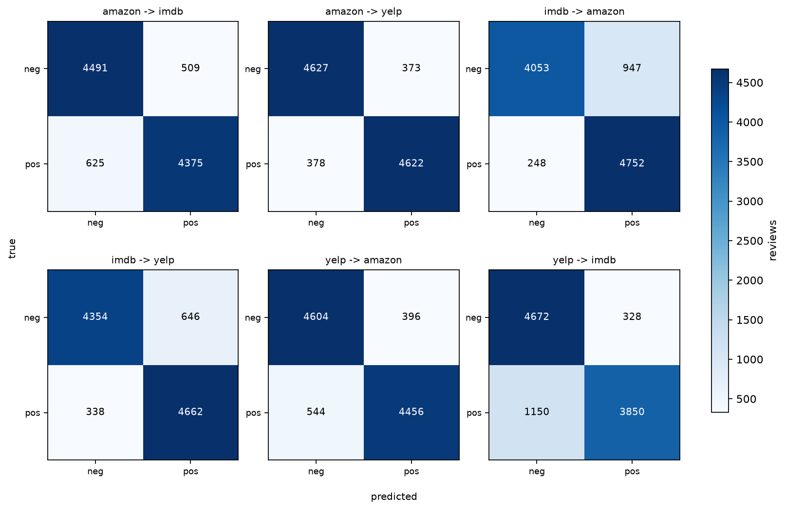

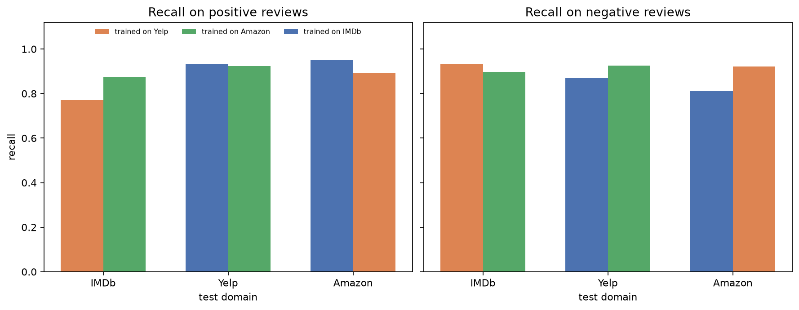

Per-class recall shows the same asymmetry. Yelp to IMDb reaches 0.770 recall on positive
reviews, while its recall on negatives is 0.934. IMDb to Amazon has the mirror image: 0.950
positive recall against 0.811 negative recall.

### 5.2 What the misclassified reviews look like

`src/run_cross.py` saves up to 120 misclassified reviews per setting, and the category counts
below come from those samples, not from all errors. A review can carry more than one tag, so the
shares are fractions of tags and sum to one only because the denominator is the tag count.

| Tag | Count | Mean words | Share of tags |
|---|---|---|---|
| contrast | 1,538 | 201.1 | 0.370 |
| negation | 1,507 | 200.0 | 0.363 |
| mixed opinion | 536 | 264.4 | 0.129 |
| long review | 287 | 486.6 | 0.069 |
| other | 257 | 49.7 | 0.062 |
| very short review | 31 | 8.3 | 0.007 |

Most failures involve contrast or negation. A typical case praises some aspects and criticises
others, with the negative clause carrying the verdict: "the topics in this book are really
great, none are covered in any detail unfortunately" is labelled negative and scored positive.
Mixed-opinion reviews make up 13 percent of the tags. Long reviews are 7 percent and are almost
all IMDb samples.

Accuracy also falls with length, in every setting:

| Setting | <=50 words | 51-100 | 101-200 | 201-400 | >400 |
|---|---|---|---|---|---|
| Yelp to IMDb | 0.901 | 0.903 | 0.902 | 0.809 | 0.705 |
| Amazon to IMDb | 0.905 | 0.919 | 0.920 | 0.868 | 0.769 |
| IMDb to Yelp | 0.904 | 0.926 | 0.918 | 0.866 | 0.748 |
| Amazon to Yelp | 0.925 | 0.947 | 0.933 | 0.905 | 0.798 |
| IMDb to Amazon | 0.887 | 0.878 | 0.875 | - | - |
| Yelp to Amazon | 0.907 | 0.905 | 0.905 | - | - |

The gaps for the two Amazon rows are not missing values: Amazon reviews average 74 words, so no
bucket above 200 words reaches the 20-review minimum this table requires. Averaged over the
cells that do exist, accuracy is 0.909 below 100 words and 0.809 above 200. Even within IMDb
the same effect appears: 0.927 on 101-200 word reviews falls to 0.826 above 400 words.
Truncation at 256 tokens is one reason, since the concluding sentence often carries the verdict.

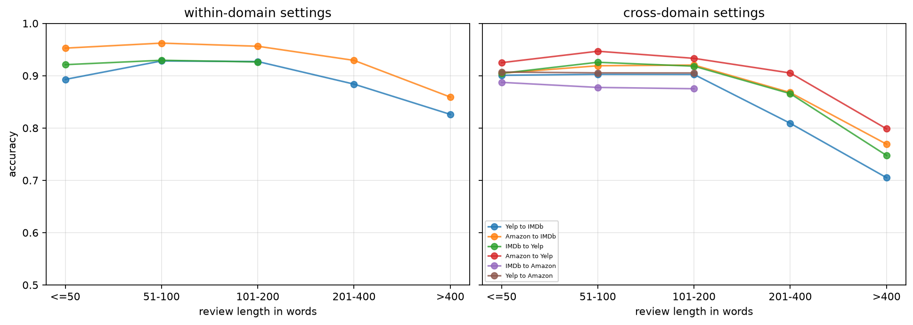

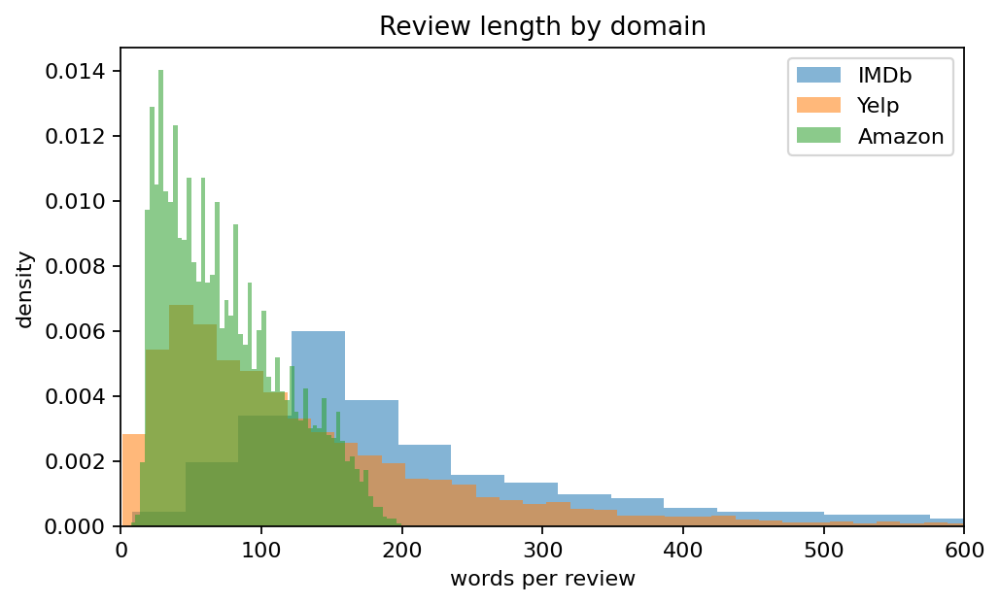

## 6. Limitations

The three datasets build their positive class differently, so part of every cross-domain drop
may come from label definition rather than from domain shift. Yelp's positive class sits at 3 to
4 stars, weaker than the other two.

The domains are not equally distant. Yelp and Amazon both collect consumer verdicts, while IMDb
collects long-form film criticism. The three are not points on a line.

Near-duplicate screening covers pairs at 0.8 Jaccard similarity and above. Paraphrases below
that threshold, especially between Amazon's film category and IMDb, could remain.

Each model was trained once per setting, except the DistilBERT within-domain runs, which were
repeated with three seeds. Training was capped at 20,000 rows to keep the comparison fair, well
below what DistilBERT can use.

Mixed-domain training holds the total training size constant. That answers whether domain
diversity helps at a fixed budget, not whether adding data from a second domain helps in
absolute terms.

## 7. Conclusion

Sentiment models do not transfer for free. Averaged over the three classifiers and the seed 42
runs, macro-F1 fell from 0.910 within a domain to 0.856 across domains. DistilBERT started
highest and lost the least, which suggests pretraining helps with vocabulary shift, though a
single seed per cross-domain setting limits how firmly that can be stated.

Which domain is the target matters more than which one the model was trained on, and the
asymmetry is systematic: long review training data transfers to short reviews almost for free,
while the reverse direction is expensive. More in-domain data does not fix this at the scale we
tested. Mixed-domain training at a fixed budget produced changes close to seed noise.

For a business reusing a model in a new review category, the practical step is to check a sample
of the new domain first and to expect the largest errors where reviews mix praise and criticism
or hinge on negation.

## 8. Reproducibility

| Step | Command |
|---|---|
| Environment | `bash scripts/setup_env.sh` |
| Tests | `python -m pytest tests -q` |
| Everything | `bash scripts/run_all.sh` |
| Data only | `python src/prepare_data.py` |

Seed 42 is fixed for sampling, splitting and training. Hyperparameters live in
`configs/final.yaml`. Every training run writes a JSON record with its settings and metrics.
All runs used one RTX 3090 with CUDA 12.2; a DistilBERT fine-tune took between 64 and 452
seconds depending on the training set size.

The data step is deterministic: a second run of `src/prepare_data.py` produced all nine parquet
files with identical md5 checksums, and re-running `src/baselines.py` reproduced the
within-domain table to six decimals.

## References

- Maas, Daly, Pham, Huang, Ng and Potts (2011). Learning word vectors for sentiment analysis. ACL-HLT.
- Zhang, Zhao and LeCun (2015). Character-level convolutional networks for text classification. NIPS.
- Sanh, Debut, Chaumond and Wolf (2019). DistilBERT, a distilled version of BERT. arXiv:1910.01108.
- McAuley and Leskovec (2013). Hidden factors and hidden topics. RecSys.
